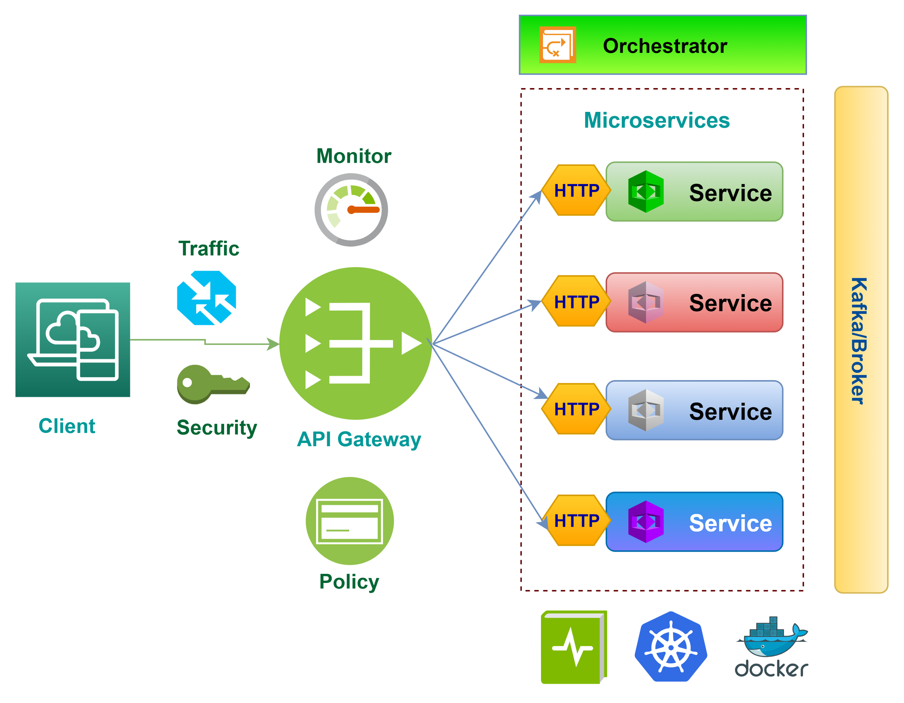
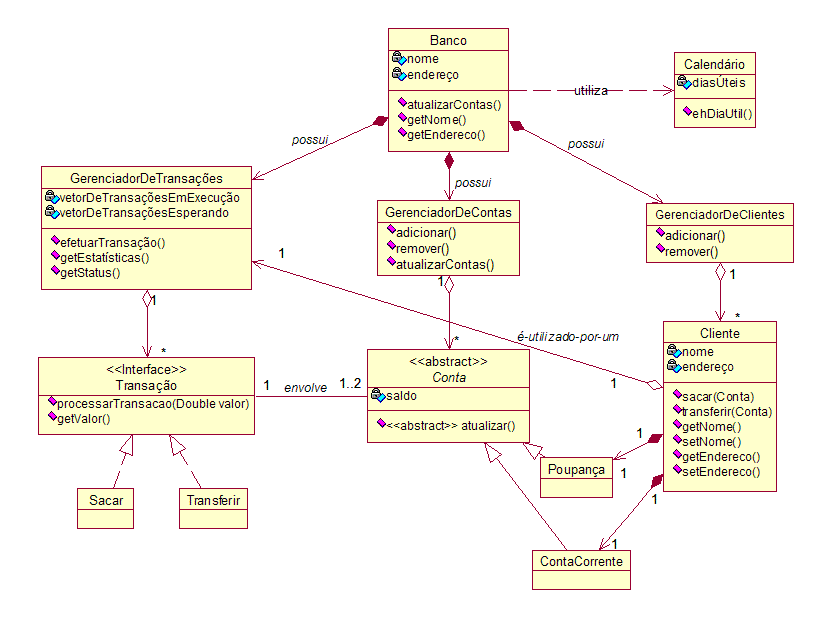
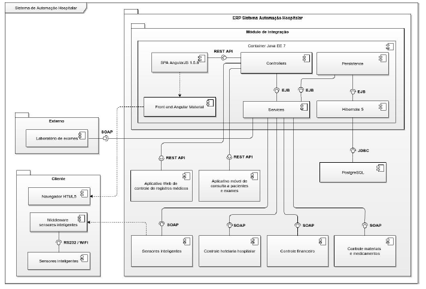

# 4. Modelagem e Projeto Arquitetural

_Apresente uma visão geral da solução proposta para o projeto e explique brevemente esse diagrama de visão geral, de forma textual. Esse diagrama não precisa seguir os padrões da UML, e deve ser completo e tão simples quanto possível, apresentando a macroarquitetura da solução._

**Figura 1 - Visão Geral da Solução (fonte: https://medium.com)**

Obs: substitua esta imagem por outra, adequada ao seu projeto (cada arquitetura é única).

## 4.1. Histórias de Usuário

| EU COMO... `PERSONA` | QUERO/PRECISO ... `FUNCIONALIDADE` | PARA ... `MOTIVO/VALOR` |
|--------------------|------------------------------------|----------------------------------------|
| Isabella (Jovem Profissional CLT) | Registrar e categorizar entradas por tipo de recurso (salário, VA, VR) | Saber exatamente quanto tenho disponível para gastar em alimentação e refeição sem misturar com a conta corrente |
| Isabella (Jovem Profissional CLT) | Importar extratos bancários em PDF ou OFX via leitura inteligente | Economizar tempo e evitar o preenchimento manual de transações no dia a dia |
| Lucas (Universitário/Estagiário) | Criar um grupo de despesas com meus amigos de república | Dividir os custos de aluguel e contas sem atritos ou cobranças manuais constrangedoras |
| Lucas (Universitário/Estagiário) | Configurar alertas e lembretes de vencimento de contas | Evitar o pagamento de juros/multas por esquecimento e manter minhas contas em dia |
| Matheus (Freelancer e Viajante) | Planejar orçamentos de viagens com conversão de moedas | Saber quanto preciso economizar e controlar os gastos durante deslocamentos internacionais |
| Matheus (Freelancer e Viajante) | Receber insights automáticos e análises preditivas via IA sobre meus hábitos | Entender meu padrão de consumo diante da minha renda oscilante e tomar decisões financeiras melhores |
| Usuário do sistema | Autenticar no aplicativo via login próprio ou OAuth (Google) | Acessar meus dados de forma simples, rápida e segura em conformidade com a LGPD |
| Administrador do sistema | Gerenciar permissões de acesso e relatórios operacionais | Garantir a integridade da plataforma e a correta segmentação dos dados entre usuários |

## 4.2. Visão Lógica

_Apresente os artefatos que serão utilizados descrevendo em linhas gerais as motivações que levaram a equipe a utilizar estes diagramas._

### Diagrama de Classes

**Figura 2 – Diagrama de classes (exemplo). Fonte: o próprio autor.**

Obs: Acrescente uma breve descrição sobre o diagrama apresentado na Figura 3.

### Diagrama de componentes

_Apresente o diagrama de componentes da aplicação, indicando, os elementos da arquitetura e as interfaces entre eles. Liste os estilos/padrões arquiteturais utilizados e faça uma descrição sucinta dos componentes indicando o papel de cada um deles dentro da arquitetura/estilo/padrão arquitetural. Indique também quais componentes serão reutilizados (navegadores, SGBDs, middlewares, etc), quais componentes serão adquiridos por serem proprietários e quais componentes precisam ser desenvolvidos._

**Figura 3 – Diagrama de Componentes (exemplo). Fonte: o próprio autor.**

_Apresente uma descrição detalhada dos artefatos que constituem o diagrama de implantação._

Ex: conforme diagrama apresentado na Figura X, as entidades participantes da solução são:

- **Componente 1** - Lorem ipsum dolor sit amet, consectetur adipiscing elit. Cras nunc magna, accumsan eget porta a, tincidunt sed mauris. Suspendisse orci nulla, sagittis a lorem laoreet, tincidunt imperdiet ipsum. Morbi malesuada pretium suscipit.
- **Componente 2** - Praesent nec nisi hendrerit, ullamcorper tortor non, rutrum sem. In non lectus tortor. Nulla vel tincidunt eros.

## 4.3. Modelo de dados (opcional)

_Caso julgue necessário para explicar a arquitetura, apresente o diagrama de classes ou diagrama de Entidade/Relacionamentos ou tabelas do banco de dados. Este modelo pode ser essencial caso a arquitetura utilize uma solução de banco de dados distribuídos ou um banco NoSQL._

 ")

**Figura 4 – Diagrama de Entidade Relacionamento (ER) - exemplo. Fonte: o próprio autor.**

Obs: Acrescente uma breve descrição sobre o diagrama apresentado na Figura 3.
