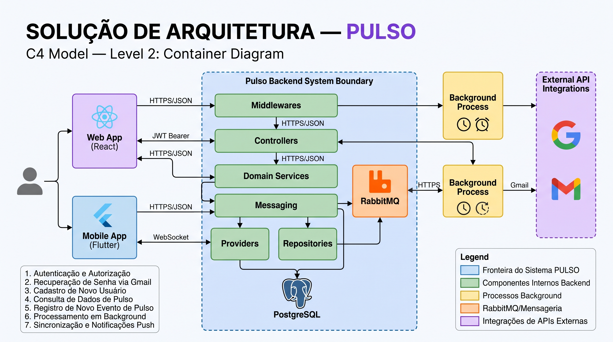
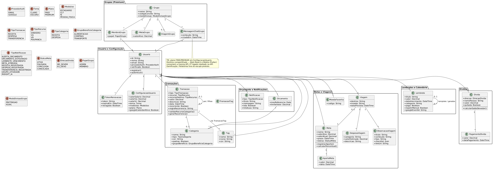
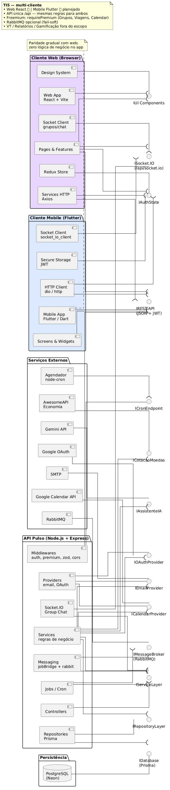
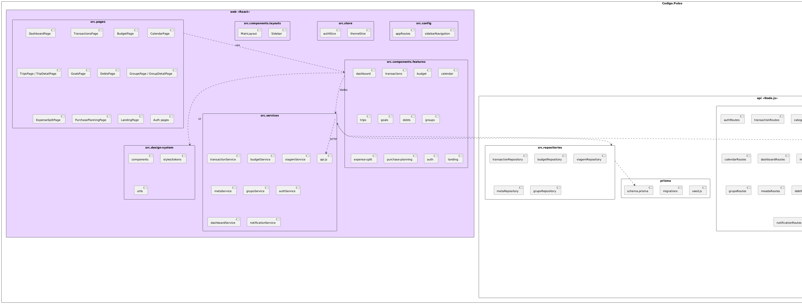
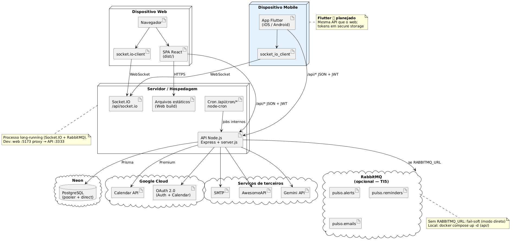
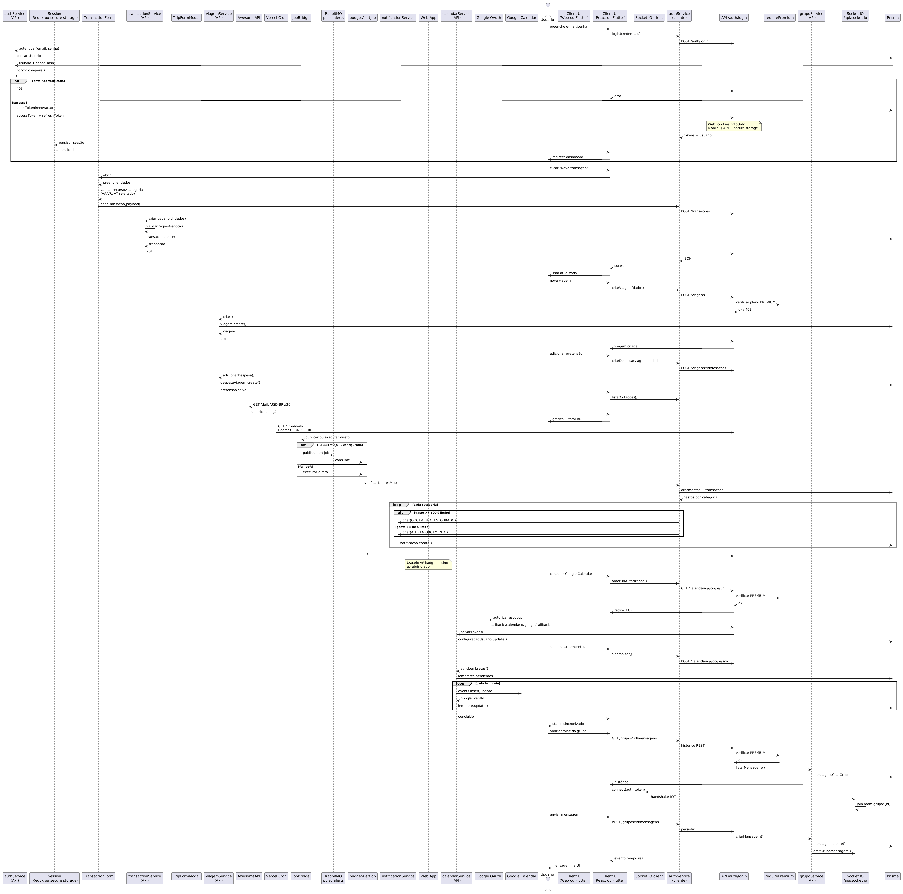
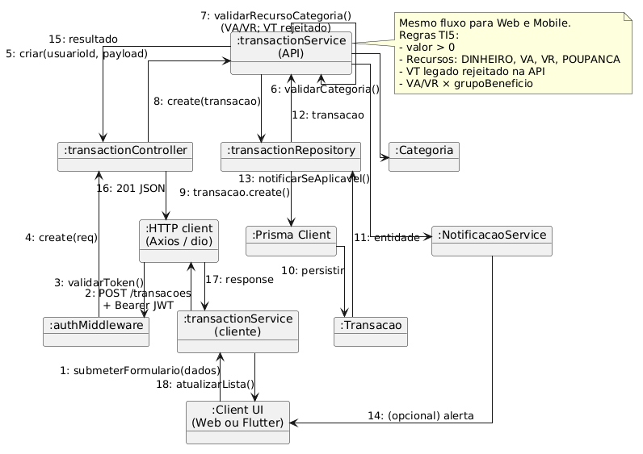
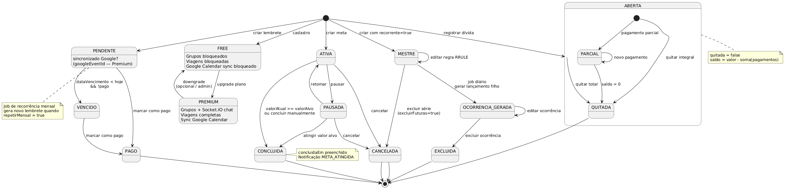

# 4. Modelagem e Projeto Arquitetural

A solução Pulso é uma aplicação de gestão financeira pessoal com **dois clientes** (Web React e Mobile Flutter) que consomem a **mesma API REST** Node.js/Express. A persistência é relacional (PostgreSQL via Prisma). Integrações externas (OAuth e Calendar do Google, SMTP, cotações AwesomeAPI, Gemini) e jobs (cron e, opcionalmente, RabbitMQ) ficam no backend — a regra de negócio não mora no app.

O diagrama a seguir mostra essa macroarquitetura no estilo C4 (nível de container): clientes, fronteira do backend (middlewares, controllers, services, repositórios, mensageria), processos em background e APIs de terceiros.

**Figura 1 — Visão geral da solução (C4 Container). Fonte: os autores.**

A Web fala HTTPS/JSON com JWT; o mobile usa o mesmo contrato e WebSocket para tempo real (grupos/chat). O banco e as filas ficam atrás da API. Fluxos típicos cobertos pelo desenho: autenticação, recuperação de senha por e-mail, cadastro, consulta e registro de dados financeiros, jobs e notificações.

Fontes PlantUML e PNG de detalhe: [`imagens/diagrams/`](imagens/diagrams/README.md).

## 4.1. Histórias de Usuário

| EU COMO... `PERSONA` | QUERO/PRECISO ... `FUNCIONALIDADE` | PARA ... `MOTIVO/VALOR` |
|--------------------|------------------------------------|----------------------------------------|
| Isabella (Jovem Profissional CLT) | Registrar e categorizar entradas por tipo de recurso (salário, VA, VR) | Saber exatamente quanto tenho disponível para gastar em alimentação e refeição sem misturar com a conta corrente |
| Isabella (Jovem Profissional CLT) | Importar extratos bancários em PDF ou OFX via leitura inteligente | Economizar tempo e evitar o preenchimento manual de transações no dia a dia |
| Lucas (Universitário/Estagiário) | Criar um grupo de despesas com meus amigos de república | Dividir os custos de aluguel e contas sem atritos ou cobranças manuais constrangedoras |
| Lucas (Universitário/Estagiário) | Configurar alertas e lembretes de vencimento de contas | Evitar o pagamento de juros/multas por esquecimento e manter minhas contas em dia |
| Matheus (Freelancer e Viajante) | Planejar orçamentos de viagens com conversão de moedas | Saber quanto preciso economizar e controlar os gastos durante deslocamentos internacionais |
| Matheus (Freelancer e Viajante) | Receber insights automáticos e análises preditivas via IA sobre meus hábitos | Entender meu padrão de consumo diante da minha renda oscilante e tomar decisões financeiras melhores |
| Usuário do sistema | Autenticar no aplicativo via login próprio ou OAuth (Google) | Acessar meus dados de forma simples, rápida e segura em conformidade com a LGPD |
| Administrador do sistema | Gerenciar permissões de acesso e relatórios operacionais | Garantir a integridade da plataforma e a correta segmentação dos dados entre usuários |

### Casos de uso

O diagrama de casos de uso resume os atores (usuário, jobs/cron, Google, AwesomeAPI, Gemini) e os pacotes de funcionalidade: conta, financeiro, metas/viagens, grupos, dívidas e insights.

**Figura 2 — Diagrama de casos de uso. Fonte: os autores.**

## 4.2. Visão Lógica

Foram usados diagramas UML de **classes**, **componentes**, **pacotes** e **implantação** para separar domínio, fatias de software e onde cada peça roda. A motivação é a mesma da arquitetura em camadas: clientes burros de regra, API única, persistência explícita.

### Diagrama de classes

O domínio gira em torno de `Usuario` e `Transacao` (receita, despesa, transferência) com `recurso` (dinheiro, VA, VR, poupança). Em torno disso: categorias, tags, orçamento, metas e aportes, viagens, dívidas, lembretes, notificações e o módulo de grupos (premium).

**Figura 3 — Diagrama de classes (domínio compartilhado Web/Mobile via API). Fonte: os autores.**

### Diagrama de componentes

Estilo em camadas: Web (React, Redux, Axios, Socket.IO) e Mobile (Flutter, storage JWT, dio) exigem `IREST` e `ISocket`. A API expõe controllers, middlewares (auth, premium, Zod), services, repositórios Prisma, jobs e providers (e-mail, OAuth, calendário, IA, cotações). Persistência: PostgreSQL (Neon). Reutilizados: navegador, SGBD, Google, SMTP, Gemini, AwesomeAPI. A desenvolver: pages/screens, services de negócio e jobs do Pulso.

**Figura 4 — Diagrama de componentes. Fonte: os autores.**

### Diagrama de pacotes

O monorepo organiza `web` (pages e features), `api` (controllers, services, repositories) e o mobile planejado. Pacotes de domínio (transações, orçamento, grupos, viagens) aparecem nos dois clientes só como UI; a regra fica na API.

**Figura 5 — Diagrama de pacotes. Fonte: os autores.**

### Diagrama de implantação

Clientes (navegador com SPA; app Flutter) falam com o host da API (Express, Socket.IO, rotas de cron). Dados no Neon; OAuth/Calendar no Google Cloud; SMTP, AwesomeAPI, Gemini e RabbitMQ como serviços externos.

**Figura 6 — Diagrama de implantação. Fonte: os autores.**

## 4.3. Modelo de dados

O modelo relacional acompanha o diagrama de classes: `usuarios`, `configuracoes_usuario`, `transacoes`, `categorias`, `orcamentos`, além de metas, viagens, grupos, dívidas, lembretes e notificações. Chaves e cardinalidades estão no PNG; o Prisma é o mapeamento de implementação.

**Figura 7 — Modelo de dados (ER simplificado). Fonte: os autores.**

## 4.4. Comportamento e fluxos

Além da estrutura estática, a apostila registra sequência, comunicação, estados e fluxo de dados dos caminhos mais críticos.

### Diagrama de sequência

O artefato cobre login (e-mail → API → bcrypt → tokens em cookie httpOnly na Web ou secure storage no mobile) e criação de transação (form → service → API → persistência e notificação).

**Figura 8 — Diagrama de sequência (login e transação). Fonte: os autores.**

### Diagrama de comunicação

Mesmo cenário de registrar transação, em vista de objetos: UI → `transactionService` → HTTP + JWT → middleware → controller → service (validação de categoria e recurso VA/VR) → repositório → Prisma → notificação.

**Figura 9 — Diagrama de comunicação (registrar transação). Fonte: os autores.**

### Diagrama de estados

Estados de **meta** (ativa, pausada, concluída, cancelada) e de **dívida** (aberta até quitada), com as transições que disparam notificação (por exemplo `META_ATINGIDA`).

**Figura 10 — Diagrama de estados (meta e dívida). Fonte: os autores.**

### Fluxo de dados

Entradas (Web, mobile, importação de extrato, OAuth, cron/RabbitMQ, Socket.IO) passam por controllers + Zod e services; saídas são JSON REST, notificações in-app e e-mail SMTP. Persistência no PostgreSQL.

**Figura 11 — Fluxo de dados. Fonte: os autores.**
