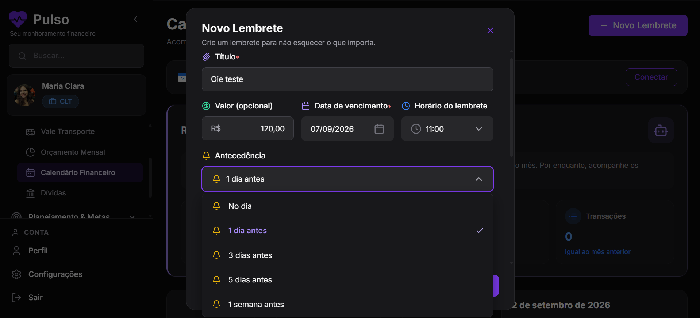

# Avaliação Heurística

**Aplicação:** Pulso! ([https://eumsmo.github.io/puc-ic/Editor/](https://eumsmo.github.io/puc-ic/Editor/))[cite: 1]

---

## 1. Introdução

### Objetivo da análise

Analisar a usabilidade da ferramenta de gestão financeira pessoal desenvolvida pelo grupo de Trabalho Interdisciplinar: Aplicações Distribuídas que pode ser acessado pelo link [https://eumsmo.github.io/puc-ic/Editor/](https://eumsmo.github.io/puc-ic/Editor/)[cite: 1]. 

### Cenário da análise

Maria precisa organizar suas finanças pessoais mensais, controlar seus gastos com cartões de crédito, registrar receitas e analisar gráficos de despesas por categoria usando a plataforma Pulso!. Ela decide explorar todos os recursos disponíveis no sistema para planejar seu orçamento, testar o cadastro de transações recorrentes e acompanhar seu saldo atualizado antes de compartilhar feedbacks com seus colegas.

### Metodologia do estudo

O estudo foi feito com a participação de 5 avaliadores, onde cada um realizou a sua avaliação individualmente e depois de todos fazerem suas análises foi construído este relatório consolidado com a triangulação dos resultados, apontando as categorias dos problemas que mais aparecem e relevantes[cite: 1]. O relatório consolidado foi construído a partir de discussões entre os participantes e casos de não concordância foram resolvidos entre as partes[cite: 1].

### Heurísticas

Foram utilizadas na avaliação as seguintes heurísticas[cite: 1]:

1. Visibilidade do estado do sistema[cite: 1]
2. Correspondência entre o sistema e o mundo real[cite: 1]
3. Controle e liberdade do usuário[cite: 1]
4. Consistência e padronização[cite: 1]
5. Prevenção de erros[cite: 1]
6. Reconhecimento em vez de memorização[cite: 1]
7. Flexibilidade e eficiência de uso[cite: 1]
8. Projeto estético e minimalista[cite: 1]
9. Apoio ao reconhecimento, diagnóstico e recuperação de erros[cite: 1]
10. Ajuda e documentação[cite: 1]

---

## 2. Avaliadores

1. Alice Shikida
2. Maria Clara
3. Matheus Felipe
4. Sofia Vasconcelos
5. Vinicius Simões

---

## 3. Principais Problemas

| #      | Problema / Título                                                            | Severidade          | Heurísticas Violadas |        Acesso Rápido         |
| ------ | ---------------------------------------------------------------------------- | ------------------- | -------------------- | :--------------------------: |
| **01** | Novo Lembrente                                                    | Cosmético            | 8                | [Ver Detalhes](#problema-01) |
| **02** | Cadastro de Metas financeiras                                                    | Pequeno            | 4,5                | [Ver Detalhes](#problema-02) |
| **03** | Conversor rápido                                                    | Pequeno            | 9                | [Ver Detalhes](#problema-03) |

---

### Problema 01

| Campo                        | Detalhes                                                                                                                                                                                                                                                                              |
| ---------------------------- | ------------------------------------------------------------------------------------------------------------------------------------------------------------------------------------------------------------------------------------------------------------------------------------- |
| **Número do Problema**       | 1                                                                                                                                                                                                                                                                                     |
| **Avaliadores**              | **1:** [ X ] &nbsp;&nbsp; **2:** [ &nbsp; ] &nbsp;&nbsp; **3:** [ X ] &nbsp;&nbsp; **4:** [ X ] &nbsp;&nbsp;   **5:** [ X ] &nbsp;&nbsp;                                                                                                                                                                                   |
| **Atividade**                | Novo Lembrente                                                                                                                                                                                                                                                         |
| **Problema**                 | No cadastro de lembrente, na parte de cdastrar a antecedêncianas opções possui o mesmo simbolo que há no título |
| **Heurística(s) violada(s)** | 8. Projeto estético e minimalista                                                                                                                                                                                                                   |
| **Severidade**               | [ ] Catastrófico &nbsp;&nbsp; [ ] Grande &nbsp;&nbsp; [ ] Pequeno &nbsp;&nbsp; [X] Cosmético                                                                                                                                                                                          |
| **Local**                    | Página Calendário Financeiro                                                                                                                                                                                                                                           |
| **Solução**                  | Retirar o simbolo de sino das opções a baixo                        |

#### Evidência(s)

[⬆ Voltar ao Sumário](#3-principais-problemas)

---

### Problema 02

| Campo                        | Detalhes                                                                                                                                                                                                                                                                                                                                                                                    |
| ---------------------------- | ------------------------------------------------------------------------------------------------------------------------------------------------------------------------------------------------------------------------------------------------------------------------------------------------------------------------------------------------------------------------------------------- |
| **Número do Problema**       | 2                                                                                                                                                                                                                                                                                                                                                                                           |
| **Avaliadores**              | **1:** [ X ] &nbsp;&nbsp; **2:** [ X ] &nbsp;&nbsp; **3:** [ X ] &nbsp;&nbsp; **4:** [ &nbsp; ] **5:** [ &nbsp; ]                                                                                                                                                                                                                                                                                             |
| **Atividade**                | Cadastro de Metas financeiras                                                                                                                                                                                                                                                                                                                                                                    |
| **Problema**                 | O usuário pode ficar cofuso com os botões da cadastrar metas, pois existe um botão "Nova Meta" e um "Criar Meta" que pode gerar duvidas no usuário sobre suas funções |
| **Heurística(s) violada(s)** | 4. Consistência e padronização 5. Prevenção de erros                                                                                                                                                                                                                                                                                                               |
| **Severidade**               | [ ] Catastrófico &nbsp;&nbsp; [ ] Grande &nbsp;&nbsp; [X] Pequeno &nbsp;&nbsp; [ ] Cosmético                                                                                                                                                                                                                                                                                                |
| **Local**                    | Metas Financeiras                                                                                                                                                                                                                                                                                                                                      |
| **Solução**                  | Manter ambos os botões com o mesmo nome, ou retirar um dos botões.                                      |

#### Evidência(s)

[⬆ Voltar ao Sumário](#3-principais-problemas)

---

### Problema 03

| Campo                        | Detalhes                                                                                                                                                                                                                                                                              |
| ---------------------------- | ------------------------------------------------------------------------------------------------------------------------------------------------------------------------------------------------------------------------------------------------------------------------------------- |
| **Número do Problema**       | 3                                                                                                                                                                                                                                                                                     |
| **Avaliadores**              | **1:** [  ] &nbsp;&nbsp; **2:** [ &nbsp; ] &nbsp;&nbsp; **3:** [  ] &nbsp;&nbsp; **4:** [ X ] &nbsp;&nbsp;   **5:** [ X ] &nbsp;&nbsp;                                                                                                                                                                                   |
| **Atividade**                | Conversor rápido                                                                                                                                                                                                                                                         |
| **Problema**                 | Há um botão com uma seta somente para um lado, dando a impressão que muda somente um lado do conversor de moeda.  |
| **Heurística(s) violada(s)** | 9. Apoio ao reconhecimento, diagnóstico e recuperação de erros                                                                                                                                                                                                                   |
| **Severidade**               | [ ] Catastrófico &nbsp;&nbsp; [ ] Grande &nbsp;&nbsp; [X] Pequeno &nbsp;&nbsp; [] Cosmético                                                                                                                                                                                          |
| **Local**                    | Viagens e Moedas                                                                                                                                                                                                                                          |
| **Solução**                  | Colocar um ícone de seta para os dois lados.                       |

#### Evidência(s)

[⬆ Voltar ao Sumário](#3-principais-problemas)

---

## 4. Resumo dos Resultados

### a. Problemas Identificados por Heurística

A avaliação apontou violações em quatro heurísticas distintas com base nos três problemas mapeados:

*   **Heurística 4 (Consistência e padronização) e Heurística 5 (Prevenção de erros):** Violadas no fluxo de cadastro de metas financeiras (Problema 02), onde a coexistência de botões com nomes diferentes ("Nova Meta" e "Criar Meta") pode gerar confusão e induzir o usuário a erros operacionais.
*   **Heurística 8 (Projeto estético e minimalista):** Violada na funcionalidade de novo lembrete (Problema 01), devido à poluição visual causada pela repetição do mesmo símbolo (sino) tanto no título quanto nas opções de antecedência.
*   **Heurística 9 (Apoio ao reconhecimento, diagnóstico e recuperação de erros):** Violada no conversor rápido (Problema 03) pela falta de clareza na affordance do botão de conversão, que exibe uma seta unidirecional e gera dúvidas sobre a bidirecionalidade da troca de moedas.

### b. Problemas Classificados por Severidade

Com base na gravidade mapeada na tabela principal, os problemas distribuem-se da seguinte forma:

*   **Problemas Pequenos:** 
    *   *Cadastro de Metas financeiras (Problema 02)*: Compromete ligeiramente a consistência e o fluxo de criação.
    *   *Conversor rápido (Problema 03)*: Afeta a interpretação visual imediata do componente de conversão.
*   **Problemas Cosméticos:** 
    *   *Novo Lembrete (Problema 01)*: Trata-se de um ruído estético menor, relacionado à redundância de ícones visuais que não impede o uso do sistema.

*(Nota: Nenhum problema classificado como Grande ou Catastrófico foi identificado nas tabelas desta rodada).*

### c. Problemas Prioritários a Serem Resolvidos

As principais prioridades de correção envolvem:
1.  **Padronização de Rótulos:** Unificar ou esclarecer a nomenclatura dos botões de ação nas Metas Financeiras ("Nova Meta" vs. "Criar Meta") para evitar ambiguidade.
2.  **Clareza de Ícones e Affordances:** Substituir a seta unilateral do conversor por um ícone bidirecional, indicando claramente a reversibilidade da conversão de moedas.
3.  **Refinamento Visual:** Remover símbolos redundantes na interface de lembretes para entregar um design mais limpo e minimalista.

---

## 5. Conclusão

De modo geral, a avaliação heurística da plataforma de gestão financeira **Pulso!** demonstrou que a aplicação possui uma proposta estruturada e funcionalidades muito úteis para o controle do orçamento pessoal (como calendário, metas e conversor de moedas). 

Contudo, foram identificadas pequenas falhas de consistência visual, redundâncias estéticas e ambiguidades em elementos de interface. A resolução desses pontos — especialmente a padronização de nomenclatura de botões e a melhoria na representação visual de ferramentas de conversão — trará um ganho expressivo de clareza. Com esses ajustes simples, a experiência de uso se tornará mais intuitiva, fluida e agradável para o usuário final.
